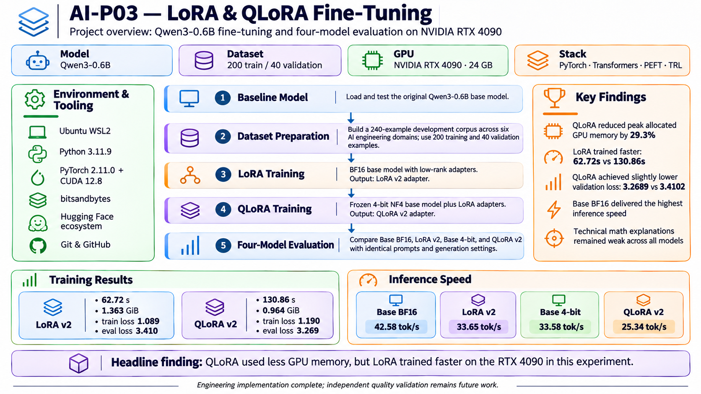
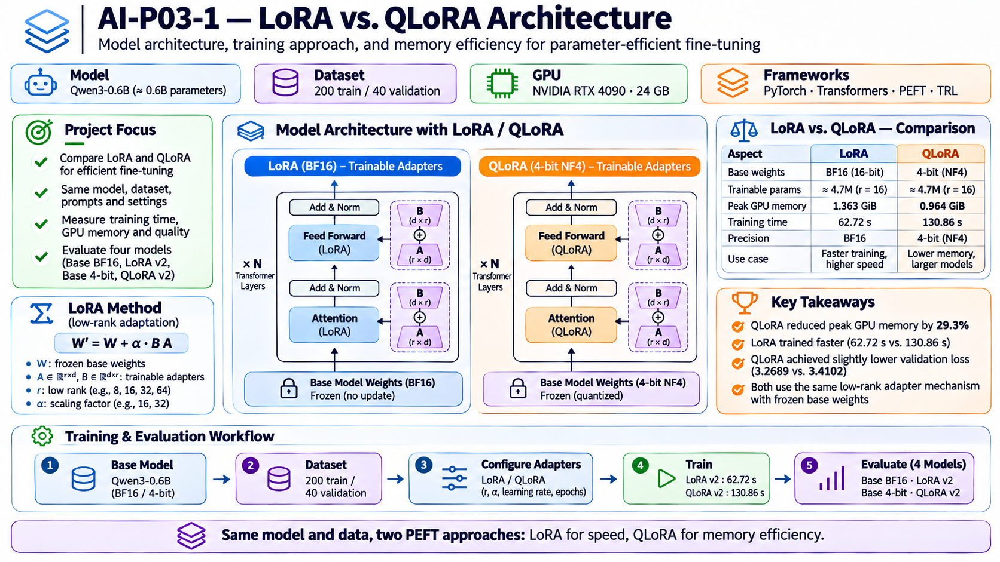
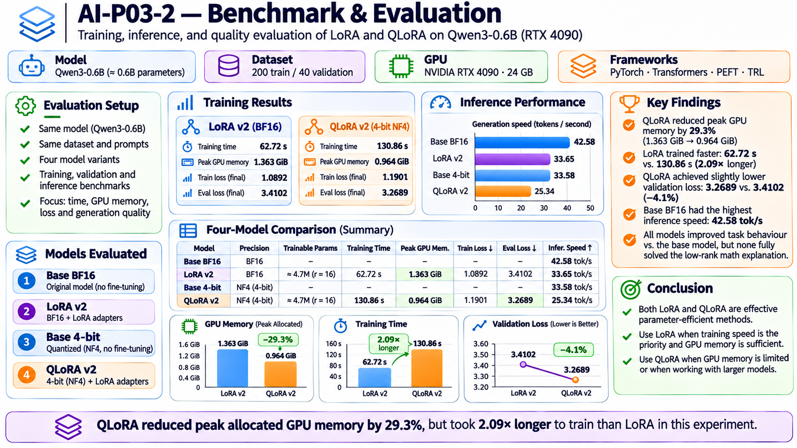

# AI-P03 — LoRA & QLoRA Fine-Tuning

### Parameter-Efficient Fine-Tuning of Qwen3-0.6B on NVIDIA RTX 4090



**AI Engineering Project 03** | PyTorch · Transformers · PEFT · TRL · CUDA

A practical AI engineering project implementing, training, and evaluating Low-Rank Adaptation (LoRA) and Quantized Low-Rank Adaptation (QLoRA).

The project compares full-precision and quantized base models, parameter-efficient fine-tuning, GPU memory requirements, training performance, and inference quality.

**Project status:** Engineering implementation complete.

---

## 1. Project Objectives

The goal is to understand and implement parameter-efficient fine-tuning techniques for large language models.

Key objectives:

- Load and evaluate a pretrained language model.
- Implement LoRA using BF16 base-model weights.
- Implement QLoRA using 4-bit NF4 quantization.
- Train both approaches on the same dataset.
- Compare training speed and GPU memory consumption.
- Evaluate four model configurations.
- Measure inference throughput and answer quality.
- Build a reproducible AI engineering project.

### Models Evaluated

| Configuration | Base Precision | Fine-Tuning |
|---|---|---|
| Base Qwen3-0.6B | BF16 | None |
| LoRA v2 | BF16 | Low-rank adapters |
| Base Qwen3-0.6B | 4-bit NF4 | None |
| QLoRA v2 | 4-bit NF4 | Low-rank adapters |

---

## 2. Technology Stack

| Component | Technology |
|---|---|
| Operating system | Windows 11 / Ubuntu WSL2 |
| Programming language | Python 3.11.9 |
| Deep learning framework | PyTorch 2.11.0 |
| CUDA | 12.8 |
| GPU | NVIDIA GeForce RTX 4090 |
| GPU memory | 23.99 GiB |
| Base model | Qwen/Qwen3-0.6B |
| Model framework | Hugging Face Transformers |
| Fine-tuning | PEFT |
| Training | TRL SFTTrainer |
| Quantization | bitsandbytes |
| Dataset processing | Hugging Face Datasets |
| Version control | Git / GitHub |

All training and inference experiments were executed locally on the RTX 4090.

---

## 3. LoRA vs. QLoRA Architecture



### LoRA — Low-Rank Adaptation

LoRA freezes pretrained model parameters and introduces small trainable low-rank matrices into selected model layers.

The adapted weight is represented as:

\[
W' = W + \frac{\alpha}{r}BA
\]

Where:

- \(W\) represents the frozen pretrained weights.
- \(A\) and \(B\) are trainable low-rank matrices.
- \(r\) is the adapter rank.
- \(\alpha\) controls adapter scaling.

For a weight matrix with dimensions \(d \times k\):

- Full matrix parameters: \(dk\)
- LoRA adapter parameters: \(r(d+k)\)

For a 4096 × 4096 matrix with rank 8:

| Method | Parameters |
|---|---:|
| Full matrix | 16,777,216 |
| LoRA update | 65,536 |
| Reduction | 99.61% |

This example describes one adapted matrix, not the full model.

### QLoRA — Quantized Low-Rank Adaptation

QLoRA combines LoRA adapters with a quantized frozen base model.

In this project:

- Base-model weights are stored using 4-bit NF4 quantization.
- Double quantization is enabled.
- BF16 is used for computation.
- Trainable low-rank adapters are added through PEFT.

QLoRA can reduce GPU memory requirements, particularly for larger models.

---

## 4. Experimental Workflow

The engineering workflow consists of:

1. Configure Python, PyTorch, CUDA and GPU access.
2. Download and load Qwen3-0.6B.
3. Establish baseline model inference.
4. Create training and validation datasets.
5. Configure LoRA adapters.
6. Train and evaluate LoRA.
7. Configure 4-bit NF4 quantization.
8. Train and evaluate QLoRA.
9. Save the trained adapters.
10. Compare all four model configurations.
11. Measure training and inference performance.
12. Assess factual correctness and limitations.

### LoRA Configuration

| Parameter | Value |
|---|---|
| Adapter rank | 8 |
| LoRA alpha | 16 |
| Dropout | 0.05 |
| Target modules | q_proj, v_proj |
| Learning rate | 2e-4 |
| Epochs | 3 |
| Batch size | 1 |
| Gradient accumulation | 2 |
| Maximum sequence length | 256 |
| Training precision | BF16 |

The same adapter configuration was used for QLoRA, with the addition of 4-bit base-model quantization.

---

## 5. Dataset

The expanded development dataset contains:

| Dataset | Examples |
|---|---:|
| Training | 200 |
| Validation | 40 |
| Total | 240 |

### Technical Domains

The dataset covers six domains:

1. Transformer architectures and attention
2. Tokenization and embeddings
3. LoRA and QLoRA
4. Training and optimization
5. Quantization and inference
6. Model evaluation

Examples include definitions, comparisons, architecture explanations, mathematical calculations, and troubleshooting scenarios.

**Dataset limitation:** The 240 records are derived from 60 underlying technical concepts using multiple question formulations.

Reference answers have not all undergone independent technical review. Consequently, the dataset is suitable for engineering experiments but should not be treated as a rigorously validated benchmark.

### Dataset Files

```text
data/
├── benchmark-v2/
│   ├── train.jsonl
│   └── eval.jsonl
├── reference/
├── smoke-test/
└── v2/
```

---

## 6. Training Experiments

Two main training experiments were performed using Qwen3-0.6B and the expanded dataset.

### LoRA v2

- BF16 base-model weights
- Low-rank adapters
- 200 training examples
- 40 validation examples
- 3 epochs

Training script:

```bash
python scripts/train_lora_v2.py
```

### QLoRA v2

- 4-bit NF4 frozen base weights
- Double quantization
- BF16 computation
- Low-rank adapters
- 200 training examples
- 40 validation examples
- 3 epochs

Training script:

```bash
python scripts/train_qlora_v2.py
```

### Measured Training Results

| Metric | LoRA v2 | QLoRA v2 |
|---|---:|---:|
| Training duration | 62.72 s | 130.86 s |
| Peak allocated GPU memory | 1.363 GiB | 0.964 GiB |
| Training loss | 1.0891 | 1.1900 |
| Validation loss | 3.4102 | 3.2689 |
| Training examples | 200 | 200 |
| Validation examples | 40 | 40 |

### Training Findings

**QLoRA reduced measured peak allocated GPU memory by approximately 29.3%.**

However, QLoRA required approximately **2.09 times as long to train** as LoRA in this experiment.

The measurements represent PyTorch peak allocated GPU memory rather than complete GPU or system memory usage.

Results are specific to this model, dataset, hardware and experimental configuration.

---

## 7. Benchmark & Evaluation



Four model configurations were evaluated using identical questions and deterministic generation settings.

### Inference Performance

| Model | Mean Tokens/Second |
|---|---:|
| Base BF16 | 42.58 |
| LoRA v2 | 33.65 |
| Base 4-bit NF4 | 33.58 |
| QLoRA v2 | 25.34 |

These values are arithmetic averages from four questions per model.

The benchmark is exploratory because generated response lengths differed and runs were not repeated enough to estimate performance variability.

### Answer Quality

The models answered four technical questions covering:

- LoRA terminology
- LoRA versus full fine-tuning
- QLoRA quantization
- Low-rank matrix mathematics

Important observations:

- LoRA v2 and QLoRA v2 correctly identified LoRA as Low-Rank Adaptation.
- The base model produced incorrect acronym explanations.
- QLoRA v2 gave a comparatively stronger short explanation of 4-bit quantization.
- None of the four configurations consistently explained low-rank mathematics correctly.

**Conclusion:** Fine-tuning changed model behavior and improved some factual answers, but reliable generalization was not demonstrated.

---

## 8. Project Directory Structure

```text
03-lora-qlora-finetuning/
├── README.md
├── baseline.py
├── requirements.txt
├── .gitignore
├── data/
│   ├── benchmark-v2/
│   ├── reference/
│   ├── smoke-test/
│   └── v2/
├── docs/
│   ├── AI-P03_Technical_Project_Guide.docx
│   └── infographics/
│       ├── AI-P03-Overview.png
│       ├── AI-P03-1-LoRA-vs-QLoRA-Architecture.png
│       └── AI-P03-2-Benchmark-Evaluation.png
├── outputs/
│   ├── lora-smoke-test/
│   ├── lora-v2/
│   ├── qlora-smoke-test/
│   └── qlora-v2/
├── results/
└── scripts/
```

The `outputs/` directory contains generated model adapters and is excluded from Git.

---

## 9. Reproducing the Experiments

### Clone the Repository

```bash
git clone https://github.com/cpgrant/03-lora-qlora-finetuning.git

cd 03-lora-qlora-finetuning
```

### Create Python Environment

```bash
python3 -m venv .venv
source .venv/bin/activate
```

### Install Dependencies

```bash
python -m pip install --upgrade pip
python -m pip install -r requirements.txt
```

The project was tested with Python 3.11.9 and an NVIDIA RTX 4090. A compatible CUDA-enabled PyTorch installation is required for GPU execution.

### Verify GPU

```bash
python -c "import torch; print(torch.cuda.is_available())"
```

Expected result on a correctly configured CUDA system:

```text
True
```

### Train LoRA

```bash
python scripts/train_lora_v2.py
```

### Train QLoRA

```bash
python scripts/train_qlora_v2.py
```

### Run Four-Model Comparison

```bash
python scripts/compare_final.py
```

The comparison requires both previously generated adapters.

Results are stored under:

```text
results/
```

---

## 10. Technical Documentation

The complete project guide provides additional information about implementation, configuration, commands, experiments, results and troubleshooting.

[Download AI-P03 Technical Project Guide (Word)](docs/AI-P03_Technical_Project_Guide.docx)

### Main Source Files

| File | Purpose |
|---|---|
| baseline.py | Original model inference |
| scripts/train_lora.py | LoRA smoke-test training |
| scripts/train_qlora.py | QLoRA smoke-test training |
| scripts/train_lora_v2.py | Expanded LoRA training |
| scripts/train_qlora_v2.py | Expanded QLoRA training |
| scripts/compare_final.py | Four-model evaluation |
| scripts/build_corpus.py | Technical reference corpus |
| scripts/expand_reference_bank.py | Dataset expansion |
| scripts/prepare_dataset.py | Dataset validation and preparation |

---

## 11. Key Engineering Lessons

### Parameter Efficiency

LoRA can dramatically reduce the number of trainable parameters by learning low-rank updates instead of updating the entire pretrained model.

### Quantization Trade-Offs

QLoRA reduced GPU memory consumption in this experiment, but introduced training overhead.

Lower-precision weights do not guarantee faster inference.

### Dataset Quality

Increasing the number of training examples does not automatically improve reasoning accuracy.

Reference-answer correctness, diversity, contamination controls and independent evaluation are essential.

### Model Evaluation

Training loss and validation loss are useful measurements, but they do not independently establish factual correctness or reasoning ability.

### Reproducibility

Versioned source code, training configurations, structured datasets, experiment results and explicit limitations make AI engineering work easier to inspect and reproduce.

---

## 12. Project Status & Future Work

### Completed

- CUDA-enabled PyTorch environment
- Base-model inference
- LoRA and QLoRA implementations
- Smoke-test experiments
- Expanded training dataset
- LoRA v2 and QLoRA v2 training
- Four-model inference comparison
- Benchmark results and technical documentation
- GitHub publication

### Future Improvements

- Independently review reference answers.
- Build a separate held-out technical test set.
- Evaluate mathematical and reasoning accuracy.
- Repeat performance measurements with controlled conditions.
- Test larger model configurations.
- Benchmark different adapter ranks and target modules.
- Compare additional fine-tuning frameworks.

---

## 13. Conclusion

AI-P03 successfully demonstrates a complete local workflow for parameter-efficient language-model fine-tuning.

The project implemented LoRA and QLoRA, trained Qwen3-0.6B on an NVIDIA RTX 4090, and measured training memory, duration, loss and inference throughput.

**Principal engineering result:**

QLoRA achieved a 29.3% reduction in measured peak PyTorch GPU allocation compared with LoRA, while requiring 2.09 times as long to train in this experimental configuration.

The project demonstrates practical fine-tuning engineering capabilities while identifying the limitations of small-scale model-quality evaluation.

---

## Repository

**AI-P03 — LoRA & QLoRA Fine-Tuning**

https://github.com/cpgrant/03-lora-qlora-finetuning

AI Engineering Project Series · 2026
